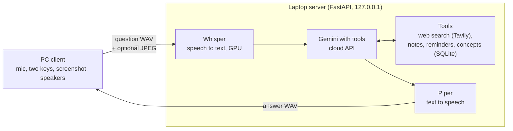

# AI Assistant (voice, v2 Teacher)

A learning companion that runs on a laptop. Hold a push-to-talk key, ask a question or give a
command, let go, and hear a short answer. v2 keeps everything from v1 (web search, notes,
reminders that are spoken when due) and adds four things: a Look key that sends a screenshot
of what you are studying with your question, a short-term session so follow-ups such as
"what is it used for?" and "tell me more" work, a concept tracker that logs what you ask to
learn, and "quiz me", which quizzes you on the concepts you logged and grades your spoken
answers.

Pipeline: microphone -> faster-whisper -> Gemini with tools (and the screenshot) -> Piper ->
speakers.

The long-term goal is a pair of glasses that act as a second brain; this is version 2.

## Demo

The v1 demo: [watch the demo video](https://youtu.be/wGKn86mIK80), a live question, a note,
and a reminder that is spoken when it is due. The v2 demo: [watch the demo video](https://youtu.be/kQE3i1y5kHM),
Look, follow-ups, and quiz me.

## Architecture



The client also polls the server every 10 s and speaks reminders when they are due.

## Keys

- **Right Alt**: voice. Hold, speak, let go.
- **Right Ctrl**: Look. Same as voice, and it also takes one screenshot at the moment you
  press, so you can ask about what is on screen.
- There is no F9 key any more.

Screenshots are shrunk, sent with the question and never saved to disk.

## Requirements

- Windows, Python 3.11.
- An NVIDIA GPU with CUDA for speech recognition (developed on an RTX 3050 Laptop, 4 GB).
- A Gemini API key and a Tavily API key. Copy `.env.example` to `.env` and fill in
  `GEMINI_API_KEY` and `TAVILY_API_KEY`. `.env` is ignored by git and must never be committed.

## Setup

```bash
python3.11 -m venv .venv
.venv/bin/python -m pip install -r requirements.txt
.venv/bin/python -m piper.download_voices en_US-lessac-medium --download-dir models
```

`requirements.txt` includes Pillow, used by the client to shrink screenshots. The speech
recognition model downloads on the first run.

## Run

Start the server first, then the client:

```bash
.venv/bin/python -m server.main
.venv/bin/python -m client_pc.client
```

Tests and checks:

```bash
.venv/bin/python -m pytest -q
.venv/bin/python -m ruff check .
.venv/bin/python -m ruff format --check .
```

### Evaluations

Both evaluations use real Gemini and are slow. Run them with the server up and the client
stopped; they back up your notes, reminders and concepts and restore them afterwards.

Record the clips once (`--set v1` is the default). The v2 Look questions also need your 20
screenshots in `data/eval_v2/screenshots/`.

```bash
.venv/bin/python -m eval.record --set v1
.venv/bin/python -m eval.record --set v2
```

v1 evaluation (30 questions):

```bash
.venv/bin/python -m eval.run_eval
```

v2 evaluation (20 Look, 10 follow-up, 20 concept and 10 quiz cases). The Gemini free tier
allows 500 requests a day, so run one group at a time. Finished cases are kept in
`data/eval_v2/progress.json` and skipped on the next run; `--fresh` starts over:

```bash
.venv/bin/python -m eval.run_eval_v2 --group look
.venv/bin/python -m eval.run_eval_v2 --group followup
.venv/bin/python -m eval.run_eval_v2 --group concept
.venv/bin/python -m eval.run_eval_v2 --group quiz
```

Reports are written to `eval/results/`. To see the last 10 logged queries:

```bash
.venv/bin/python -m eval.live_log
```

## Measured results

### v1 regression (30 questions, re-run on the v2 code)

From `eval/results/2026-10-17_1611.md`:

| Check | Result | Pass mark |
| --- | --- | --- |
| General and live questions | 8/10 (80%) | 80% |
| Notes | 10/10 (100%) | 80% |
| Reminders | 10/10 (100%) | 80% |
| Transcription | 26/30 (87%) | at least 26/30 for the regression |
| Median time, key release to answer | 3.4 s (worst 9.6 s) | 15 s |
| Errors | 0 | none |

### v2 (20 Look, 10 follow-up, 20 concept and 10 quiz cases)

From `eval/results/2026-10-18_2340_v2.md`, run group by group on the final code:

| Check | Result | Pass mark |
| --- | --- | --- |
| Look questions | 17/20 (85%) | 80% |
| Follow-ups | 8/10 (80%) | 8 of 10 |
| Concept logging | 19/20 (95%) | 90% |
| Quiz grading | 10/10 (100%) | 8 of 10 |
| Look latency, median (worst) | 4.8 s (9.3 s) | median 8 s |
| Errors | 0 | none |

## Known limits

- Rare names are sometimes misheard (for example "ISRO" heard as "Israel").
- Speech recognition is English only.
- In a rare worst case (about 20 s) the assistant may say it could not look something up,
  or return an error.
- The Gemini free tier limits requests per minute and per day.

## Privacy

Audio stays on the laptop: it is transcribed locally and never uploaded. The question text,
tool results and, for Look, the screenshot are sent to Gemini; the search query alone is sent
to Tavily. Notes, reminders and concepts are stored in a local SQLite database that is not
committed.

## Roadmap

- v3: Memory (it knows me and recalls past conversations as short key points).
- v4: Planner and habits (helps run my day).
- v5: Cloud (the server moves off the laptop).
- v6: Own models (open-source models replace cloud APIs where good enough).
- v7: Wearable (the client becomes the glasses).

Details are in `docs/roadmap.md`.
