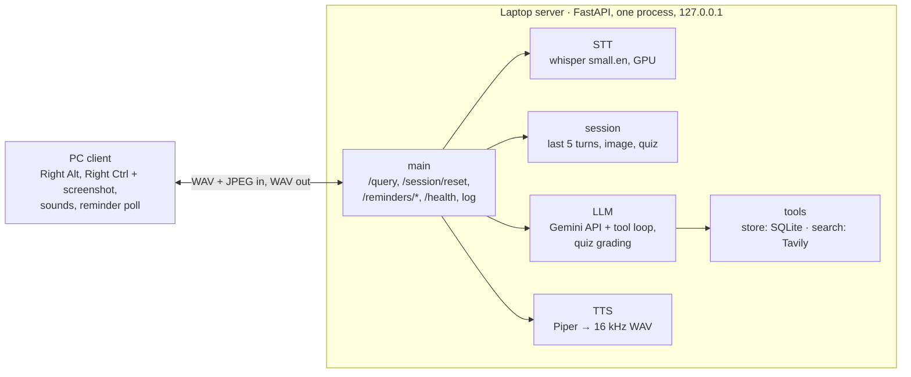

Version 2. See roadmap.md.

# AI Assistant v2 Design: Teacher

Updated Oct 14, 2026 · Bhavik Fulfagar

One FastAPI process on the laptop runs speech-to-text and text-to-speech locally, calls Gemini
for the answer, keeps notes, reminders and concepts in SQLite, and holds one short session in
memory. A push-to-talk Python client on the same laptop calls it with two keys: Right Alt for
voice and Right Ctrl for voice plus a screenshot. Requirements are in spec.md.

## Architecture

Serves all FRs. The `/query` handler is the only place that knows the order of the stages;
each stage is a small module, so any of them can be swapped without touching the others.



| Block | Job |
| --- | --- |
| PC client | Right Alt records voice; Right Ctrl records voice and takes one screenshot at |
| | key press; plays start, thinking and error sounds; sends the WAV (and JPEG) and |
| | plays the answer. Every 10 s, when idle, polls and plays due reminders. |
| main.py | Validates audio and image, runs the stages in order, times each one, routes a |
| | quiz answer, returns the WAV or an error, writes the log line. Serves |
| | `/session/reset`, the reminder endpoints and `/health`. |
| STT (`stt.py`) | Question WAV → text with faster-whisper `small.en`, loaded once at startup. |
| Session (`session.py`) | New. One in-memory session behind a lock: last 5 turns, the most |
| | recent image, the quiz state, and their expiry. |
| LLM (`llm.py`) | Sends the question, session turns and image to Gemini with the system |
| | instruction and tool declarations; runs the tool-call loop; grades a quiz answer. |
| Tools (`tools.py`) | The nine declarations, the dispatcher (always returns a result dict) and |
| | the spoken texts (reminders, quiz questions, score). |
| Search (`search.py`) | Query → top web results from the Tavily Search API; raises on failure. |
| Store (`store.py`) | SQLite: notes, reminders and concepts. |
| TTS (`tts.py`) | Answer text → speech with Piper, resampled to 16 kHz mono 16-bit. |
| Logger (`logger.py`) | One JSONL line per query, failed ones included. |
| Gemini API, Tavily Search API | The only parts that need the internet. |

## Live search through a `web_search` tool

Serves FR-5, FR-7. Unchanged from v1.

The M3 spike (Oct 10, 2026, results in archive/v1/plan.md) showed that Google Search
grounding has no API quota on our free tier: every request with the `google_search` tool
returned 429. On `gemini-3.5-flash-lite` with our key, plain calls and function calling work.
So Gemini never searches itself; the server searches for it.

- Model: `gemini-3.5-flash-lite` (free tier: 15 requests per minute, 500 per day). Timeout
  10 s per call, the minimum the API accepts (8 s is rejected).
- Every request carries the function declarations, with no built-in tools. Function calling
  uses `VALIDATED` mode.
- When Gemini calls `web_search`, `tools` passes the query to `search.py`, which calls the
  Tavily Search API (basic depth, a few top results, timeout from config). The results go
  back as `{results: [{title, url, content}]}`; a failure goes back as `{error}`.
- `searched` is true when `web_search` ran and returned results.
- When Gemini returns function calls, the server runs them and sends back all response parts
  unchanged (including `id` and `thought_signature`) plus the results, up to 3 rounds.
- Deadline: the LLM stage has a 15 s deadline (`LLM_DEADLINE_S`). Before each Gemini call,
  `llm` checks that the call's full timeout fits in the time left. The first search always
  runs; a later tool round runs only if elapsed + its tool timeout (0 s local tools, 5 s
  search) + 10 s <= `LLM_FINAL_DEADLINE_S` (18 s), else its calls get an error result
  marked refused. When the deadline stops the model, `llm` makes one last Gemini call with
  function calling mode NONE if elapsed <= `LLM_FINAL_START_MAX_S` (8 s); only if that is
  not possible or fails does it raise `llm: deadline exceeded`. The worst case is STT 1 s +
  LLM 18 s + TTS 1 s = 20 s, under the client's 25 s.
- Privacy rule: `web_search` sends only the search query to Tavily. Never send notes,
  reminders, concepts, screenshot content or (from v3) memory content as a query. Tavily's
  terms let it use queries and results to improve its models.
- Backup provider: Exa (`exa-py`, $10 free credit a month, no card). Switching changes only
  `search.py` and its config.
- SDK details change between versions: check the current `google-genai` and `tavily-python`
  docs before changing `llm.py` and `search.py`.

## Look: screenshot with the question

Serves FR-19, FR-20, FR-16, FR-17.

- Client: on Right Ctrl press, Pillow `ImageGrab` takes one screenshot of the screen; the
  client shrinks it so the longest side is at most 1280 px, encodes it as JPEG in memory and
  sends it as the `image` field with the audio. It is never written to disk.
- Server: `main.py` checks the image before any stage: over 2 MB gives 400
  `image too large`; a file Pillow cannot open as JPEG or PNG gives 400
  `image is not a readable image`.
- `llm` sends the image to Gemini as an image part next to the question text, and the
  session keeps it as the most recent image (FR-21).
- The log records `image_sent` true or false, never the image.
- Pillow is a new dependency, pending approval. The first task of the Look milestone is a
  spike that confirms the capture, the resize, the JPEG size and the Gemini image part.

## Sessions

Serves FR-21, FR-22, FR-17.

- `session.py` holds one session in memory, guarded by a `threading.Lock` (`/query` is a
  plain `def` and runs in FastAPI's thread pool).
- It keeps only the final question and answer text of the last 5 turns plus the most recent
  image (bytes and type), never tool calls or tool results.
- The session ends 120 s after the last answer (`SESSION_TTL_S`); while a quiz runs, it
  waits up to 300 s for each answer instead (FR-24). An expired session is cleared on the
  next read.
- `llm` sends the saved turns as earlier user and model text contents, then the new question
  with the new image, or else the most recent saved image.
- `POST /session/reset` clears the turns, the image and any running quiz; returns 200
  `{"status": "ok"}`. The eval calls it before each question.
- The log records `session_continued` true when the question used saved turns.
- Restarting the server clears the session; nothing of it is stored.

## Concepts

Serves FR-23, FR-25, FR-17.

- New tool `log_concept(name, summary)`. Gemini calls it for learning questions only (the
  system instruction gives "what is LoRA?" as a learning question and "when is Diwali?" as
  not one).
- The system instruction lists the existing concept names, so Gemini reuses a name for the
  same concept. `store` matches names case-insensitively: a match updates `last_asked`
  (and the summary), a new name adds a row with status `new`.
- New tool `learned_this_week()` returns the count of concepts first asked in the last 7
  days and the names of the 5 most recent.
- The log records the concept name logged in that query, if any.
- No embeddings.

## Quiz

Serves FR-24.

- Gemini calls the tool `start_quiz()` when I say "quiz me". The server picks up to 3
  concepts (status new, oldest first asked first; then status wrong, oldest last quizzed
  first), stores the quiz state in the session and returns the first question. With no
  concept to quiz it returns a count of 0, and Gemini says so.
- The question is a fixed template: "Explain <name> in one sentence." The system instruction
  tells Gemini to read it exactly.
- While a quiz runs, `main.py` routes the next `/query` as an answer, whatever the key:
  1. STT as usual.
  2. If the transcript contains "stop quiz" (lowercase, no punctuation), the quiz ends; the
     statuses so far stay; the answer is "Quiz stopped." No Gemini call.
  3. Else one Gemini grading call (`llm.grade`), no tools, JSON output
     `{correct, feedback}`, with the concept name, its summary and my answer.
  4. `store` sets the status to right or wrong and the date last quizzed.
  5. The spoken answer is the one-line feedback plus the next question, or plus the score
     ("2 of 3 right") after the last one, which ends the quiz.
- If no answer comes within 300 s, the quiz ends quietly; that concept keeps its status.
- A grading failure is a 500 `llm: <reason>`; the quiz stays on the same question.

## System instruction

Serves FR-5, FR-6, FR-10, FR-23, FR-24. A constant in `llm.py`, with values filled in per
request.

- Current date, weekday and time in the configured time zone (Asia/Kolkata); home city.
- Answer in at most 3 sentences and at most 60 words. A list says the total count and the
  first 5 items (newest notes, soonest reminders); "tell me more" gives the next 5 or one
  more short layer, within the same limit.
- Call `web_search` when a question needs live information; put the date or the home city
  in the query when needed; never put notes, reminders, concepts or screen content in it.
- Use the tools for notes and reminders; turn relative times into an exact ISO 8601 time
  with offset; repeat `due_spoken`, never an ISO timestamp or an id.
- After any action, repeat it back with the stored values; on a tool error, say what went
  wrong.
- Call `log_concept` for learning questions only; the existing concept names are listed.
- Call `start_quiz` on "quiz me" and read the returned question exactly.
- With an image, answer about what is in it.

## Storage

Serves FR-8, FR-9, FR-12 to FR-14, FR-23 to FR-25.

One SQLite file at `data/assistant.db` (path in config, gitignored), opened by `store.py`;
tables are created at startup.

| Table | Columns |
| --- | --- |
| notes | id, text, created_at |
| reminders | id, text, due_at, created_at, status (pending, delivered, cancelled) |
| concepts | id, name (unique, case-insensitive), summary, first_asked, last_asked, |
| | status (new, right, wrong), last_quizzed (empty until quizzed) |

Times are stored as ISO 8601 strings with the configured offset. A reminder is due when
`status = pending` and `due_at ≤ now`; only `POST /reminders/{id}/ack` sets `delivered`, so a
reminder survives a client crash. It is "missed" when it was due 60 s or more before the
audio is fetched (threshold in config). Concepts are never deleted.

## Tool functions

Serves FR-7 to FR-10, FR-23 to FR-25. The v1 six plus three new ones.

| Tool | Arguments | Result sent back to Gemini |
| --- | --- | --- |
| `web_search` | `query` | `{results: [{title, url, content}]}` or `{error}` |
| `add_note` | `text` | `{id, text, created_at}` |
| `list_notes` | none | `{notes: [{id, text, created_at}]}` |
| `add_reminder` | `text`, `due_at` | `{id, text, due_at, due_spoken}` or `{error}` |
| `list_reminders` | none | `{reminders: [{id, text, due_at, due_spoken}]}` |
| `cancel_reminder` | `id` | `{id, text, due_at, status: "cancelled"}` or `{error}` |
| `log_concept` | `name`, `summary` | `{name, summary, status, new}` or `{error}` |
| `learned_this_week` | none | `{count, names}` |
| `start_quiz` | none | `{count, question}` (`question` empty when `count` is 0) |

## Logging

Serves FR-17. One JSONL line per `/query`: time, question, answer, per-stage timings,
`searched`, tool calls, error, plus `image_sent`, `session_continued` and `concept`. Each
tool call has name, arguments and `status`: ok, failed, or refused (no time left, issue #59).
No key or token ever appears; error text is cut and keys are redacted as in v1.

## Tech stack

Everything is Python. Only the Gemini and web search calls leave the laptop.

| Part | Choice | Why |
| --- | --- | --- |
| Server | Python 3.11, FastAPI + Uvicorn, 127.0.0.1 | File uploads; no other device |
| STT | faster-whisper `small.en`, CUDA, float16 | Fast on the RTX 3050 (4 GB) |
| LLM | `gemini-3.5-flash-lite`, `google-genai`, minimal thinking | Tools and images, free tier |
| Web search | Tavily through `tavily-python` | 1,000 free credits a month |
| Storage | SQLite through `sqlite3` | One local file |
| Time | `zoneinfo` + `tzdata` | Exact times on Windows |
| TTS | Piper (`piper-tts`), one English voice | Fast and offline |
| Client | sounddevice, pynput (Right Alt, Right Ctrl), httpx | Small, already pinned |
| Screenshot and image check | Pillow (new, pending approval) | Capture, resize, JPEG, verify |
| Config | `.env` for keys; `server/config.py`, `client_pc/config.py` | Keys never in git |
| Tests | pytest with fakes; `run_eval.py` and `run_eval_v2.py` | One command per eval |

## Config

New values; every other v1 value stays.

| File | Value | Setting |
| --- | --- | --- |
| client_pc/config.py | `VOICE_KEY = "alt_r"` | replaces `PTT_KEY = "f9"` |
| client_pc/config.py | `LOOK_KEY = "ctrl_r"` | |
| client_pc/config.py | `SCREENSHOT_MAX_SIDE_PX = 1280` | |
| client_pc/config.py | `SCREENSHOT_JPEG_QUALITY` | set by the Look spike |
| server/config.py | `IMAGE_MAX_BYTES = 2_000_000` | 2 MB |
| server/config.py | `SESSION_TTL_S = 120`, `SESSION_MAX_TURNS = 5` | |
| server/config.py | `ANSWER_MAX_SENTENCES = 3`, `ANSWER_MAX_WORDS = 60` | |
| server/config.py | `LIST_MAX_ITEMS = 5` | |
| server/config.py | `QUIZ_MAX_CONCEPTS = 3`, `QUIZ_ANSWER_WAIT_S = 300` | |
| server/config.py | `QUIZ_QUESTION = "Explain {name} in one sentence."` | |
| server/config.py | `QUIZ_STOP_PHRASE = "stop quiz"` | |
| server/config.py | `LEARNED_DAYS = 7`, `LEARNED_MAX_NAMES = 5` | |
| eval/config.py | `V2_QUESTIONS_PATH`, `V2_DATA_DIR`, `V2_SCREENSHOT_DIR` | paths |
| eval/config.py | `LOOK_MEDIAN_MAX_S = 8` | v2 targets in spec.md |

## Timeouts and errors

Serves FR-3, FR-5, FR-16, FR-24. Each timeout is shorter than the one above it.

| Layer | Timeout | On failure |
| --- | --- | --- |
| LLM stage | 15 s deadline; last call by 8 s, ends by 18 s | Last call; else `llm` 500 |
| Gemini call | 10 s, at most 3 tool rounds | Error naming the `llm` stage |
| Quiz grading call | 10 s, one call, no tools | `llm` 500; quiz stays on question |
| `web_search` | 5 s | `{"error": ...}` to Gemini |
| Notes, reminders, concepts | none (local SQLite) | `{"error": ...}` to Gemini |
| Server `/query` | none of its own | 400 bad audio or image; 500 stage |
| Session | 120 s after last answer | Cleared quietly |
| Quiz answer | 300 s | Quiz ends quietly |
| Client query | 25 s (`QUERY_TIMEOUT_S`) | Error sound; next key press works |
| Client reminder poll | 20 s (`POLL_TIMEOUT_S`) | Skipped; retried next poll |

## Repo structure

One file per block, so each task touches as few files as possible. New in v2 are marked.

```text
ai-glasses/
├── CLAUDE.md  README.md  requirements.txt  .env.example  .gitignore
├── docs/
│   ├── roadmap.md        # final goal and versions v1–v7
│   ├── brief.md  spec.md  design.md  plan.md   # current version (v2)
│   ├── hardware_plan.md  # older hardware reference, for v7
│   └── archive/          # vN/ copies of finished versions' docs
├── server/
│   ├── main.py           # /query, /session/reset, /reminders/*, /health; stage order
│   ├── config.py         # all server settings; reads .env
│   ├── stt.py            # faster-whisper
│   ├── llm.py            # Gemini + tool-call loop + system instruction + quiz grading
│   ├── session.py        # NEW: in-memory session, last 5 turns, image, quiz state
│   ├── tools.py          # tool declarations, dispatch, spoken texts
│   ├── search.py         # Tavily web search for the web_search tool
│   ├── store.py          # SQLite: notes, reminders, concepts
│   ├── tts.py            # Piper + resample to 16 kHz
│   └── logger.py         # JSONL line
├── client_pc/
│   ├── client.py         # two keys, screenshot, sounds, reminder polling
│   └── config.py         # server address, keys, screenshot size, timeouts, poll
├── tests/
│   ├── conftest.py       # fakes, a fake screen grab, a temporary database
│   ├── test_server.py    # endpoint tests
│   └── test_<module>.py  # one module's own logic (NEW: test_session.py)
├── eval/
│   ├── questions.json    # frozen v1 30-question set, for the regression run
│   ├── questions_v2.json # NEW: frozen v2 set (Look, follow-ups, concepts, quiz)
│   ├── config.py         # eval paths, pacing, targets
│   ├── record.py         # records the v1 clips, and the v2 clips with a set option
│   ├── run_eval.py       # v1 eval: accuracy + latency
│   ├── run_eval_v2.py    # NEW: v2 eval, reuses run_eval.py helpers
│   ├── live_questions.md # 10 questions to speak with the key
│   ├── live_log.py       # prints the last 10 logged queries
│   └── results/          # <date>.md and .json per run
├── data/                 # gitignored
│   ├── assistant.db
│   ├── eval/             # v1 clips
│   └── eval_v2/          # NEW: v2 clips, and screenshots/ for the Look questions
├── models/               # Piper voice files, gitignored
└── logs/                 # queries.jsonl, gitignored
```

## Eval

Serves the v2 quality targets in spec.md.

- The v1 set (`eval/questions.json`) stays frozen and is re-run unchanged for the regression
  target with `run_eval.py`.
- The v2 set is `eval/questions_v2.json`, frozen after its first run. Each row names its
  clip and, for Look, its screenshot file.
- v2 clips and the saved screenshots live in `data/eval_v2/` (gitignored, like the v1 clips):
  screenshots of my study material may hold private or copyrighted content.
- `eval/record.py` gets an option `--set v2` that uses
  `eval/questions_v2.json` and saves clips to `data/eval_v2/`
  (no new recorder file).
- `run_eval_v2.py` calls `POST /session/reset` before each row (follow-up cases run as one
  sequence), backs up and restores notes, reminders and concepts as `run_eval.py` does, paces
  Gemini calls, and writes `eval/results/<date>_v2.md` and `.json`.

## Key decisions

| Decision | Chosen | Instead of | Why |
| --- | --- | --- | --- |
| Live info | `web_search` run by the server | Search grounding | No grounding quota |
| Server shape | One process, models loaded at startup | Separate services | Simplest |
| Transport | One HTTP POST per question, full WAV | Streaming | Fits push-to-talk |
| Reminder delivery | Poll, fetch audio, then ack | Server push | Nothing lost |
| Storage | SQLite file on the laptop | A hosted database | Private, no setup |
| Network | 127.0.0.1 only | Wi-Fi | Auth comes with v5 |
| Audio format | 16 kHz mono 16-bit everywhere | Each tool's rate | One format |
| Look image | One JPEG, ≤ 1280 px, per question | Video, full size | Cost, latency |
| Session | In memory, text of 5 turns + image | Stored, with tools | Small, private |
| Concepts | Gemini tool + names in the prompt | Embeddings | No new model |
| Quiz flow | Server owns state; one grading call | Gemini runs it | Predictable |
| Quiz question | Fixed template | Gemini writes it | Same every time |

## Risks and mitigations

| Risk | Mitigation |
| --- | --- |
| Free tier: 15 RPM, 500 RPD | Pace evals; a quiz adds one call per answer |
| Images slow the Gemini call | 1280 px JPEG; Look latency in the log and the eval |
| Look on a private screen | Never used there (brief); screenshots never saved |
| Gemini logs a non-learning question | Examples in the instruction; eval measures it |
| Gemini makes a duplicate concept | Names listed in the prompt; case-insensitive match |
| Concept list grows long in the prompt | Fine for v2; v3 adds search |
| "Stop quiz" misheard during a quiz | It is graded as wrong; I can ask again |
| Right Alt reported as AltGr by pynput | Checked in the client key spike |
| Follow-up loses context after 120 s | Expected by FR-21; the eval resets per row |
| Private content leaks into search queries | Instruction rule; every query is logged |
| Tavily changes its free plan | Swap `search.py` for Exa |
