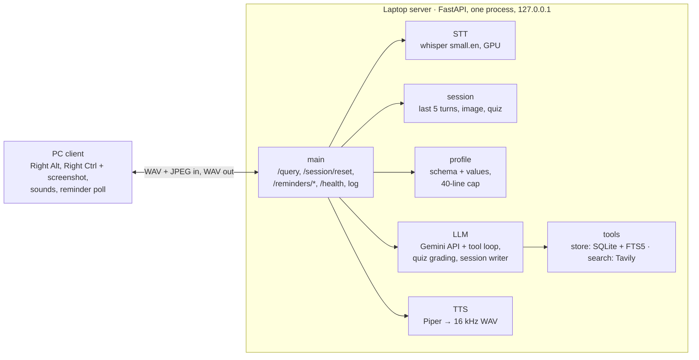

Version 3. See roadmap.md.

# AI Assistant v3 Design: Memory

Updated Oct 20, 2026 · Bhavik Fulfagar

One FastAPI process on the laptop runs speech-to-text and text-to-speech locally, calls Gemini
for the answer, keeps notes, reminders, concepts and memories in SQLite, and holds one short
session in memory. v3 adds two things on top of v2: a profile of fixed slots that goes into
every prompt, and short memory items that outlive the session and are found again by
searching. A push-to-talk Python client on the same laptop calls it with two keys: Right Alt
for voice and Right Ctrl for voice plus a screenshot. Requirements are in spec.md.

## Architecture

Serves all FRs. The `/query` handler is the only place that knows the order of the stages;
each stage is a small module, so any of them can be swapped without touching the others. v3
adds one module, `profile.py`, and widens `store.py`; nothing else moves.



| Block | Job |
| --- | --- |
| PC client | Unchanged from v2. Right Alt records voice; Right Ctrl records voice and |
| | takes one screenshot at key press; plays start, thinking and error sounds; |
| | sends the WAV (and JPEG) and plays the answer. Every 10 s, when idle, polls |
| | and plays what is due. |
| main.py | Validates audio and image, runs the stages in order, times each one, routes |
| | a quiz answer or a setup answer, returns the WAV or an error, writes the log |
| | line. Serves `/session/reset`, the reminder endpoints and `/health`. Runs the |
| | session writer when the reminder poll finds an expired session. |
| STT (`stt.py`) | Question WAV → text with faster-whisper `small.en`, loaded once at startup. |
| Session (`session.py`) | One in-memory session behind a lock: last 5 turns, the most recent |
| | image, the quiz state, the setup state, and their expiry. |
| Profile (`profile.py`) | NEW. Loads the schema and the values at startup, enforces the |
| | 40-line cap, renders the profile block for the system instruction, writes a |
| | slot after a confirmed update or a setup answer. |
| LLM (`llm.py`) | Sends the question, session turns, profile and image to Gemini with the |
| | system instruction and tool declarations; runs the tool-call loop; grades a |
| | quiz answer; runs the session writer call. |
| Tools (`tools.py`) | The declarations, the dispatcher (always returns a result dict) and the |
| | spoken texts (reminders, quiz questions, score, setup questions). |
| Search (`search.py`) | Query → top web results from the Tavily Search API; raises on failure. |
| Store (`store.py`) | SQLite: notes, reminders, concepts and memories, plus the FTS5 index. |
| TTS (`tts.py`) | Answer text → speech with Piper, resampled to 16 kHz mono 16-bit. |
| Logger (`logger.py`) | One JSONL line per query, failed ones included. |
| Gemini API, Tavily Search API | The only parts that need the internet. |

## Unchanged from v2

These parts are not touched by v3 and are described in `docs/archive/v2/design.md`:
live search through a `web_search` tool (FR-5, FR-7), Look and the screenshot path
(FR-19, FR-20), the concept tracker (FR-23, FR-25), and the quiz (FR-24).

One v2 risk is now a measured defect rather than a worry: Gemini reusing an existing concept
name for a different concept (issue #116, found in the 2026-10-20 re-baseline). The memory
writer has the same shape, so FR-40 makes not doing it a tested requirement rather than an
instruction and a hope.

## Profile

Serves FR-26 to FR-29, FR-31.

- `config/profile_schema.yaml` defines the slots: name, a one-line description, and the
  question asked at setup. It is committed to git: it is structure, not personal data.
- `data/profile.yaml` holds the values. It is **gitignored**, like `assistant.db`, because
  it holds identity, goals and weak spots. The repo is private today, but git history is
  permanent and the repo may not always be.
- `profile.py` loads both at startup. A malformed schema raises at startup with a clear
  message. A value whose slot is not in the schema is ignored and logged, not an error. A
  missing values file means an empty profile, which triggers setup.
- The rendered profile block is built once per request and placed in the system instruction.
  Empty slots are left out entirely, so an empty profile adds nothing.
- The 40-line cap (`PROFILE_MAX_LINES`) is enforced **at load**, not at render, so an
  oversized profile fails once at startup instead of silently on every query.
- Setup (FR-29) runs when the values file is missing or empty. The session holds the setup
  state, like the quiz state: each key press answers the current slot, and `SETUP_STOP_PHRASE`
  ("stop setup") leaves setup keeping what was answered. While setup runs, `/query` skips the
  Gemini call entirely — the next question is an answer to a setup slot, not a question.
- A slot update outside setup (FR-31) needs a yes. The assistant proposes through its answer;
  the session holds the pending proposal; the next turn's yes commits it. A declined proposal
  is remembered for the session so it is not asked twice.

## Memory and recall

Serves FR-32 to FR-38, FR-40.

- A memory item is a row: text (≤ 12 words), type (`fact`, `project`, `preference`,
  `session`), and the date stored. The word limit is checked in `store.py` before insert, so
  no path can store a long item.
- Recall goes through one function, `store.search_memories(query, k, since=None)`. That
  signature is the interface the spec freezes; the implementation behind it is replaceable.
- v3 implements it with **SQLite FTS5**, which ships with SQLite and adds no dependency. A
  contentless FTS5 table indexes the item text and stays in sync with the memories table
  through triggers, so there is one source of truth.
- At most 5 items (`MEMORY_RECALL_MAX`) are passed to Gemini. The full store is never sent,
  to Gemini or to Tavily. This is a size rule first: the store grows forever, a prompt
  cannot.
- A named time (FR-38) is turned into a date range by Gemini, which passes `since` to the
  tool. An unparseable time means no filter rather than no results.
- Forget (FR-34) searches, and acts only on exactly one match. Two or more matches return
  the candidates to Gemini, which names them and asks; nothing is deleted until the next turn
  names one. Deletes are real `DELETE` statements, not a status flag.
- Over-merge (FR-40) is prevented the way the v2 concept bug taught us it must be: the
  decision is not left to a line in the prompt. `remember` and the writer both pass their
  candidate text through `store.find_same(text)`, which returns a match only above a
  similarity floor; anything below it is a new row. The prompt also says it, but the store
  is what enforces it.

## Session writer

Serves FR-39.

The session ends 120 s after the last answer, but nothing runs at that moment: the server
only acts when asked. v3 reuses the poll the client already makes.

- Every 10 s the idle client calls `GET /reminders/due`. If that call finds the session
  expired and unwritten, the server runs the writer before answering the poll.
- The writer is one Gemini call with no tools, a 10 s timeout and JSON output, in the same
  shape as the v2 quiz grader: it gets the session's turns and the profile, and returns 0 to
  3 key points.
- Each returned point goes through the same word-limit and `find_same` checks as `remember`.
- The spoken line ("Noted two things.") is delivered as a **notice row** in the reminders
  table, which the poll already knows how to fetch, speak and acknowledge. This is why v3
  needs no new endpoint and no new field: a notice is reminder-shaped. The table gets a
  `kind` column (`reminder` or `notice`) used only inside `store.py`; `list_reminders`
  filters to `kind = 'reminder'` so notices never appear in "what are my reminders?".
- The writer never blocks a user query: it runs on the poll, after the answer has been
  spoken, so it is outside the latency path in spec.md.
- **Known limitation, stated rather than hidden:** the writer only runs while the client is
  open. Close the client straight after a conversation and that session's points are lost.
  A background timer in the server would fix it and is not worth the machinery in v3.

## System instruction

Serves FR-5, FR-6, FR-10, FR-23, FR-24, FR-28, FR-31, FR-33, FR-34, FR-37. A constant in
`llm.py`, with values filled in per request. v2's rules are unchanged; v3 adds the first and
the last four.

- The profile block, rendered by `profile.py`, at the top. Use it to pitch the answer at my
  level and weigh advice against my goals.
- Current date, weekday and time in the configured time zone (Asia/Kolkata); home city.
- Answer in at most 3 sentences and at most 60 words. A list says the total count and the
  first 5 items.
- Call `web_search` when a question needs live information; never put notes, reminders,
  concepts, screen content or memory content in the query.
- Use the tools for notes and reminders; repeat `due_spoken`, never an ISO timestamp or an id.
- After any action, repeat it back with the stored values; on a tool error, say what went
  wrong.
- Call `log_concept` for learning questions only; call `start_quiz` on "quiz me".
- With an image, answer about what is in it.
- Call `remember` for "remember that ...", shortening to a key point within the word limit
  and picking the type; read back what was stored.
- Call `search_memories` for a question about me or about what we have discussed. With a
  named time, pass `since`. Answer only from what comes back; if nothing does, say you do
  not know rather than guessing.
- Call `forget` to delete; when it returns more than one candidate, name them and ask which,
  and do not delete until answered.
- Never reuse an existing memory's wording for a different point. Two things that are not the
  same thing are two items.

## Storage

Serves FR-8, FR-9, FR-12 to FR-14, FR-23 to FR-25, FR-32 to FR-38.

One SQLite file at `data/assistant.db` (path in config, gitignored), opened by `store.py`;
tables are created at startup.

| Table | Columns |
| --- | --- |
| notes | id, text, created_at |
| reminders | id, text, due_at, created_at, status (pending, delivered, cancelled), |
| | kind (reminder, notice) |
| concepts | id, name (unique, case-insensitive), summary, first_asked, last_asked, |
| | status (new, right, wrong), last_quizzed |
| memories | id, text, type (fact, project, preference, session), created_at |
| memories_fts | FTS5 contentless index over memories.text, kept in sync by triggers |

Times are ISO 8601 strings with the configured offset. `kind` is new in v3 and defaults to
`reminder`, so existing rows need no migration. A wipe (FR-35) deletes every row in
`memories`; the triggers clear the index with it. Notes, reminders, concepts and the profile
are untouched by a wipe.

## Tool functions

Serves FR-7 to FR-10, FR-23 to FR-25, FR-31, FR-33, FR-34, FR-36, FR-37, FR-38. The v2 nine
plus four.

| Tool | Arguments | Result sent back to Gemini |
| --- | --- | --- |
| `web_search` | `query` | `{results: [{title, url, content}]}` or `{error}` |
| `add_note` | `text` | `{id, text, created_at}` |
| `list_notes` | none | `{notes: [...]}` |
| `add_reminder` | `text`, `due_at` | `{id, text, due_at, due_spoken}` or `{error}` |
| `list_reminders` | none | `{reminders: [...]}` (notices excluded) |
| `cancel_reminder` | `id` | `{id, text, due_at, status}` or `{error}` |
| `log_concept` | `name`, `summary` | `{name, summary, status, new}` or `{error}` |
| `learned_this_week` | none | `{count, names}` |
| `start_quiz` | none | `{count, question}` |
| `remember` | `text`, `type` | `{id, text, type, created_at}` or `{error}` |
| `search_memories` | `query` (optional), `since` (optional) | `{count, items: [{id, text, type, created_at}]}` |
| `forget` | `query` | `{deleted: {...}}`, or `{candidates: [...]}` when more than one matches, or `{error}` |
| `update_profile` | `slot`, `value` | `{slot, value}` or `{error}` |

Four decisions behind that list, each one keeping the count down. Thirteen declarations
already go into every request, and a longer list is itself a source of wrong tool choices.

- `search_memories` with no `query` is "list my memories" (FR-36), so listing needs no tool
  of its own.
- Wipe (FR-35) is **not** a tool. The confirmation phrase is matched in `main.py` against the
  transcript, exactly as `QUIZ_STOP_PHRASE` already is. Destructive and exact-match is server
  logic, not something a language model should be able to decide to call.
- `update_profile` is only reachable after a yes; `main.py` refuses the call when no proposal
  is pending.
- Setup answers never reach Gemini at all.

## Logging

Serves FR-17. One JSONL line per `/query`, as in v2, plus three fields: `memories_used` (how
many items were passed, never their text), `memory_written` (how many the writer kept, on the
poll line) and `profile_lines`. Memory text never appears in the log, so the log can be read
and pasted without leaking what is stored. No key or token ever appears.

## Tech stack

Everything is Python. Only the Gemini and web search calls leave the laptop. v3 adds no
dependency.

| Part | Choice | Why |
| --- | --- | --- |
| Server | Python 3.11, FastAPI + Uvicorn, 127.0.0.1 | File uploads; no other device |
| STT | faster-whisper `small.en`, CUDA, float16 | Measured 26/30; `medium.en` scored 27/30 at +1.1 s, so the swap waits for v6 |
| LLM | `gemini-3.5-flash-lite`, `google-genai`, minimal thinking | Tools and images, free tier |
| Web search | Tavily through `tavily-python` | 1,000 free credits a month |
| Storage | SQLite through `sqlite3` | One local file |
| Memory search | SQLite FTS5 | Built in; no dependency, no model, no VRAM |
| Profile files | PyYAML | Already in the venv as a transitive dependency; confirm before use |
| Time | `zoneinfo` + `tzdata` | Exact times |
| TTS | Piper (`piper-tts`), one English voice | Fast and offline |
| Client | sounddevice, pynput, httpx | Unchanged from v2 |
| Screenshot | Pillow | Capture, resize, JPEG, verify |
| Config | `.env` for keys; `server/config.py`, `client_pc/config.py` | Keys never in git |
| Tests | pytest with fakes; three eval runners | One command per eval |
| Compute | RTX 4060 Laptop GPU, 8 GB | Holds Whisper; memory search is CPU and SQLite |

If PyYAML is not already present, the profile files become JSON rather than adding a
dependency. Check before building M13.

## Config

New values; every other v1 and v2 value stays.

| File | Value | Setting |
| --- | --- | --- |
| server/config.py | `PROFILE_SCHEMA_PATH = "config/profile_schema.yaml"` | committed |
| server/config.py | `PROFILE_VALUES_PATH = "data/profile.yaml"` | gitignored |
| server/config.py | `PROFILE_MAX_LINES = 40` | checked at load |
| server/config.py | `SETUP_SLOTS = [identity, goal_now, goal_long, exploring, style, constraints]` | FR-29 |
| server/config.py | `SETUP_STOP_PHRASE = "stop setup"` | |
| server/config.py | `GOAL_STALE_DAYS = 31` | FR-30 |
| server/config.py | `MEMORY_MAX_WORDS = 12` | FR-32 |
| server/config.py | `MEMORY_RECALL_MAX = 5`, `MEMORY_LIST_MAX = 5` | FR-36, FR-37 |
| server/config.py | `MEMORY_SAME_THRESHOLD` | FR-40; set by the M13 spike |
| server/config.py | `WIPE_CONFIRM_PHRASE = "yes wipe everything"` | FR-35 |
| server/config.py | `WRITER_MAX_POINTS = 3`, `WRITER_TIMEOUT_S = 10` | FR-39 |
| eval/config.py | `V3_QUESTIONS_PATH`, `V3_DATA_DIR`, `V3_SEED_PATH` | paths |
| eval/config.py | `V3_MEDIAN_MAX_S = 5.3` | v3 target in spec.md |

`MEMORY_SAME_THRESHOLD` is the one value that cannot be guessed. The first M13 task is a
spike that measures it against the five near-miss pairs, the way the Look spike set the JPEG
quality.

## Timeouts and errors

Serves FR-3, FR-5, FR-16, FR-24, FR-39. v2's rows are unchanged; the writer is new.

| Layer | Timeout | On failure |
| --- | --- | --- |
| LLM stage | 15 s deadline; last call by 8 s, ends by 18 s | Last call; else `llm` 500 |
| Gemini call | 10 s, at most 3 tool rounds | Error naming the `llm` stage |
| Quiz grading call | 10 s, one call, no tools | `llm` 500; quiz stays on question |
| Session writer call | 10 s, one call, no tools | Logged; points lost; poll answers normally |
| Memory search | none (local SQLite + FTS5) | `{"error": ...}` to Gemini |
| `web_search` | 5 s | `{"error": ...}` to Gemini |
| Server `/query` | none of its own | 400 bad audio or image; 500 stage |
| Session | 120 s after last answer | Cleared, then written |
| Client query | 25 s (`QUERY_TIMEOUT_S`) | Error sound; next key press works |
| Client reminder poll | 20 s (`POLL_TIMEOUT_S`) | Skipped; retried next poll |

The writer runs inside the poll, whose client timeout is 20 s; a 10 s writer call fits. A
writer failure must never fail the poll, because the poll also delivers real reminders.

## Repo structure

New in v3 are marked. Only two paths are added.

```text
ai-glasses/
├── CLAUDE.md  README.md  requirements.txt  .env.example  .gitignore
├── config/                # NEW: committed, structure not data
│   └── profile_schema.yaml
├── docs/
│   ├── roadmap.md
│   ├── brief.md  spec.md  design.md  plan.md   # current version (v3)
│   ├── hardware_plan.md
│   └── archive/           # vN/ copies of finished versions' docs
├── server/
│   ├── main.py            # stage order; wipe phrase; setup routing; writer on poll
│   ├── config.py
│   ├── stt.py
│   ├── llm.py             # Gemini + tool loop + system instruction + grading + writer
│   ├── session.py         # turns, image, quiz state, setup state, pending proposal
│   ├── profile.py         # NEW: schema + values, cap, render, write
│   ├── tools.py
│   ├── search.py
│   ├── store.py           # notes, reminders, concepts, memories, FTS5
│   ├── tts.py
│   └── logger.py
├── client_pc/             # unchanged in v3
│   ├── client.py
│   └── config.py
├── tests/
│   ├── conftest.py
│   ├── test_server.py
│   └── test_<module>.py   # NEW: test_profile.py
├── eval/
│   ├── questions.json     # frozen v1 set
│   ├── questions_v2.json  # frozen v2 set
│   ├── questions_v3.json  # NEW: frozen v3 set
│   ├── seed_v3.json       # NEW: the seeded store the recall questions are asked against
│   ├── config.py
│   ├── record.py          # --set v3 added
│   ├── run_eval.py
│   ├── run_eval_v2.py
│   ├── run_eval_v3.py     # NEW: reuses run_eval.py helpers
│   ├── live_questions.md
│   ├── live_log.py
│   └── results/
├── data/                  # gitignored
│   ├── assistant.db
│   ├── profile.yaml       # NEW: personal; never committed
│   ├── eval/  eval_v2/
│   └── eval_v3/           # NEW: v3 clips
├── models/                # gitignored
└── logs/                  # gitignored
```

`CLAUDE.md`'s "Project structure" section must be updated in the same milestone that creates
`config/`, or the two disagree.

## Eval

Serves the v3 quality targets in spec.md.

- The v1 and v2 sets stay frozen and are re-run unchanged for the regression targets.
- The v3 set is `eval/questions_v3.json`, frozen after its first run: 20 recall questions,
  10 remember commands, 5 forget cases, 10 questions about things never stated, 5 near-miss
  pairs, and one setup run of 6 answers.
- `eval/seed_v3.json` is the store the recall questions are asked against. It is committed,
  because it is invented test data, not my real memories. `data/assistant.db` is never used.
- `run_eval_v3.py` backs up and restores the memories table **and `data/profile.yaml`**, not
  just notes, reminders and concepts. A run that leaves a test profile behind would change
  every later answer.
- Quota: the writer adds one call per session, and the 10 writer sessions are 10 extra calls
  on top of the question rows. Budget the v3 run against the 500-a-day limit before starting;
  the 2026-10-20 re-baseline showed how little headroom a same-day second run has.

## Key decisions

v2's decisions still hold. New in v3:

| Decision | Chosen | Instead of | Why |
| --- | --- | --- | --- |
| Recall | SQLite FTS5 behind one interface | Embeddings now | No dependency; the eval decides whether more is needed |
| Retrieval contract | `search(query, k, since)` | Direct SQL in callers | The backend can change without touching callers |
| Profile shape | Fixed slots in a schema file | Free-form facts | "What is the profile" is answerable, and another user re-skins it |
| Profile values | `data/profile.yaml`, gitignored | `config/profile.yaml` | Identity, goals and weak spots do not belong in git history |
| Profile size | Hard 40-line cap, fails at load | Silent truncation | A silently cut profile is a silently wrong answer |
| Slot writes | Proposed, confirmed by a yes | Silent self-editing | A quietly corrupted always-on prompt is near impossible to debug |
| Writer trigger | On the existing reminder poll | A background timer | No new machinery; accepts that it needs the client open |
| Writer delivery | A notice row in the reminders table | A new endpoint or field | Keeps the frozen API contract |
| Over-merge guard | In `store.py` | In the prompt only | Issue #116 is what a prompt-only rule buys |
| Wipe | Phrase matched in `main.py` | A `wipe` tool | A model should not be able to choose to delete everything |
| Compaction | Not in v3 | Merge and roll up now | Tuning it needs months of real data; v4 |

## Risks and mitigations

| Risk | Mitigation |
| --- | --- |
| FTS5 misses paraphrased recalls | Exactly what the recall target measures; embeddings are the planned fallback |
| `MEMORY_SAME_THRESHOLD` set too high or low | Measured by an M13 spike against the 5 near-miss pairs, not guessed |
| Writer never runs because the client is closed | Stated as a known limitation; a timer is a v4 option |
| 13 tool declarations confuse tool choice | Wipe and listing were kept out; the eval measures wrong calls |
| Profile grows past 40 lines | Fails at load with the cap named, not at query time |
| Personal profile committed by accident | Values live under the already-gitignored `data/` |
| A test run leaves a seeded profile behind | `run_eval_v3.py` backs up and restores the profile too |
| Free tier: 15 RPM, 500 RPD | The writer adds a call per session; budget the run in advance |
| Memory text leaking into a search query | Instruction rule plus the v2 logging of every query |
| Memory text leaking into the log | The log stores counts, never memory text |
| Concept over-merge (issue #116) still open in v2 | Not fixed in v2; FR-40 tests the same failure in v3's own writer |
