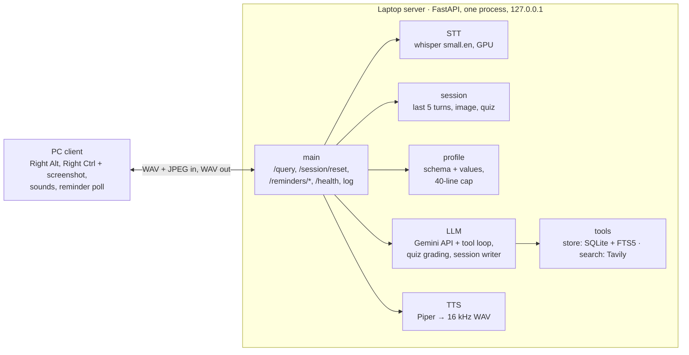

Version 3. See roadmap.md.

# AI Assistant v3 Design: Memory

Updated Oct 20, 2026 · Bhavik Fulfagar

One FastAPI process on the laptop runs speech-to-text and text-to-speech locally, calls Gemini
for the answer, keeps notes, reminders, concepts and memories in SQLite, and holds one short
session in memory. v3 adds two things on top of v2: a profile of fixed slots that goes into
every prompt, and short memory items that outlive the session and are found again by
searching. A push-to-talk Python client on the same laptop calls it with two keys: Right Alt
for voice and Right Ctrl for voice plus a screenshot. Requirements are in spec.md.

## Architecture

Serves all FRs. The `/query` handler is the only place that knows the order of the stages;
each stage is a small module, so any of them can be swapped without touching the others. v3
adds one module, `profile.py`, and widens `store.py`; nothing else moves.



| Block | Job |
| --- | --- |
| PC client | Unchanged from v2. Right Alt records voice; Right Ctrl records voice and |
| | takes one screenshot at key press; plays start, thinking and error sounds; |
| | sends the WAV (and JPEG) and plays the answer. Every 10 s, when idle, polls |
| | and plays what is due. |
| main.py | Validates audio and image, runs the stages in order, times each one, routes |
| | a quiz answer or a setup answer, returns the WAV or an error, writes the log |
| | line. Serves `/session/reset`, the reminder endpoints and `/health`. Runs the |
| | session writer when the reminder poll finds an expired session. |
| STT (`stt.py`) | Question WAV → text with faster-whisper `small.en`, loaded once at startup. |
| Session (`session.py`) | One in-memory session behind a lock: last 5 turns, the most recent |
| | image, the quiz state, the setup state, and their expiry. |
| Profile (`profile.py`) | NEW. Loads the schema and the values at startup, enforces the |
| | 40-line cap, renders the profile block for the system instruction, writes a |
| | slot after a confirmed update or a setup answer. |
| LLM (`llm.py`) | Sends the question, session turns, profile and image to Gemini with the |
| | system instruction and tool declarations; runs the tool-call loop; grades a |
| | quiz answer; runs the session writer call. |
| Tools (`tools.py`) | The declarations, the dispatcher (always returns a result dict) and the |
| | spoken texts (reminders, quiz questions, score, setup questions). |
| Search (`search.py`) | Query → top web results from the Tavily Search API; raises on failure. |
| Store (`store.py`) | SQLite: notes, reminders, concepts and memories, plus the FTS5 index and |
| | the word-overlap checks on a text (`find_same`, forget, the writer guard). |
| TTS (`tts.py`) | Answer text → speech with Piper, resampled to 16 kHz mono 16-bit. |
| Logger (`logger.py`) | One JSONL line per query, failed ones included. |
| Gemini API, Tavily Search API | The only parts that need the internet. |

## Unchanged from v2

These parts are not touched by v3 and are described in `docs/archive/v2/design.md`:
live search through a `web_search` tool (FR-5, FR-7), Look and the screenshot path
(FR-19, FR-20), the concept tracker (FR-23, FR-25), and the quiz (FR-24).

One v2 risk is now a measured defect rather than a worry: Gemini reusing an existing concept
name for a different concept (issue #116, found in the 2026-10-20 re-baseline). The memory
writer has the same shape, so FR-40 makes not doing it a tested requirement rather than an
instruction and a hope.

## Sessions

Serves FR-21, FR-22, FR-29, FR-31, FR-39. v2's behaviour is unchanged; v3 adds two pieces of
state and one consequence.

- `session.py` holds one session in memory, guarded by a `threading.Lock`.
- It keeps the final question and answer text of the last 5 turns plus the most recent image,
  never tool calls or tool results.
- The session ends 120 s after the last answer (`SESSION_TTL_S`); while a quiz runs it waits
  up to 300 s per answer. An expired session is cleared on the next read.
- NEW: it also holds the **setup state** (which slot is being asked, and the answers so far)
  and any **pending slot proposal** (the slot, the proposed value, and whether it was already
  declined this session). Both sit behind the same lock as the quiz state.
- NEW, and the reason the writer does not lose sessions: an expired session is **handed to a
  pending-write buffer before it is cleared**, by whichever read clears it. Without this, a
  `/query` arriving between expiry and the next poll would clear the turns first and the
  writer would have nothing to write. `/query` never runs the writer itself — that would add
  a Gemini call to the user's latency path — it only moves the turns aside.
- The buffer is the single source of truth for "not yet written": a session in it is
  unwritten, and taking it out for the writer is what makes the writer run exactly once per
  session. There is no separate flag, because a second mechanism for the same fact can
  drift from the first. A session with no turns is never buffered.
- The buffer holds at most `WRITER_PENDING_MAX` (3) expired sessions. The poll takes one per
  call. If the client is closed the buffer fills, and the oldest is dropped with a log line
  rather than growing without limit.
- `POST /session/reset` clears the turns, the image, a running quiz, the setup state, any
  pending proposal **and the pending-write buffer**, so a reset session is never written
  afterwards. This is what keeps eval rows from leaking memories into each other.
- Restarting the server clears the session. Setup answers already written to disk survive;
  an unfinished setup restarts from the first unanswered slot.

## Profile

Serves FR-26 to FR-29, FR-31.

- `config/profile_schema.json` defines the slots: name, a one-line description, and the
  question asked at setup. It is committed to git: it is structure, not personal data.
- `data/profile.json` holds the values. It is **gitignored**, like `assistant.db`, because
  it holds identity, goals and weak spots. The repo is private today, but git history is
  permanent and the repo may not always be.
- `profile.py` loads both at startup. A malformed schema raises at startup with a clear
  message. A value whose slot is not in the schema is ignored and logged, not an error. A
  missing values file means an empty profile, which triggers setup.
- The rendered profile block is built once per request and placed in the system instruction.
  Empty slots are left out entirely, so an empty profile adds nothing.
- The 40-line cap (`PROFILE_MAX_LINES`) counts **rendered lines** — the lines that actually
  enter the system instruction, one per non-empty slot plus any wrapped continuation — not
  lines in the file. JSON has no comments, but the two still differ: an empty slot is a file
  line that renders nothing, and a long value is one file line that renders as several
  lines. It is enforced **at load and at every write**. At load it fails fast at startup
  rather than silently on every query. At write, a confirmed
  `propose_profile_update` or setup answer that would take the profile over the cap is refused and
  the caller is told; without that check a write could succeed and then stop the server
  starting next time.
- Setup (FR-29) runs when the values file is missing or empty. The session holds the setup
  state, like the quiz state: each key press answers the current slot, and `SETUP_STOP_PHRASE`
  ("stop setup") leaves setup keeping what was answered. The match accepts "setup" as one word
  or two (`SETUP_STOP_PATTERN`, `stop` immediately before `set up`, never a bare "set up"):
  Whisper split it in two of two logged runs ("Stop, send up.", "Stop. Set up."), so the only
  way out failed about half the time. No setup answer plausibly contains "stop set up", so
  this is one tight pattern, not loose matching. The quiz and wipe phrases are unchanged. Setup also runs when any of the six
  setup slots is unanswered, and then asks only the unanswered ones, in schema order, so a
  half-finished setup resumes after a restart instead of staying blank forever. "stop setup"
  suppresses it for the rest of that server run. Each answer is read back in the same turn as
  the next question: the profile is in every prompt, so a silent speech-recognition error there
  degrades every answer, and `remember` already reads back for the same reason. While setup runs, `/query` skips the
  Gemini call entirely — the next question is an answer to a setup slot, not a question.
- A slot update outside setup (FR-31) needs a yes. The assistant calls `propose_profile_update`
  in its turn and asks the question in its answer; the session holds the pending proposal; the
  next turn's yes commits it. A declined proposal is remembered for the session so it is not
  asked twice.
- `data/profile.json` stays a flat map of slot to text, plus one reserved key, `_set_on`: an
  object of slot to `YYYY-MM-DD`, the date each slot was last written or confirmed. It never
  renders, never counts toward the cap, and is not a slot. A hand-written file may omit it; a
  slot with no date is never called stale, and nothing is stamped at load. `goal_now`'s date
  drives FR-30. The stale line is appended to the answer by the server, not left to the model,
  and registers a pending confirmation. A yes to it re-stamps the date and leaves the value
  unchanged; re-stamping a date is not editing the goal. Without that, the line would repeat
  every session for a goal that has not changed.

## Memory and recall

Serves FR-32 to FR-38, FR-40.

- A memory item is a row: text (≤ 12 words), type (`fact`, `project`, `preference`,
  `session`), and the date stored. The word limit is checked in `store.py` before insert, so
  no path can store a long item.
- Recall goes through one function, `store.search_memories(query, k, since=None,
  until=None)`. That signature is the interface the spec freezes; the implementation behind
  it is replaceable.
- v3 implements it with **SQLite FTS5**, which ships with SQLite and adds no dependency. A
  contentless FTS5 table indexes the item text and stays in sync with the memories table
  through triggers, so there is one source of truth.
- At most 5 items (`MEMORY_RECALL_MAX`) are passed to Gemini. The full store is never sent,
  to Gemini or to Tavily. This is a size rule first: the store grows forever, a prompt
  cannot.
- A named time (FR-38) is turned into a date range by Gemini, which passes `since` and
  `until` to the tool. An unparseable bound means no filter rather than no results.
- Forget (FR-34) deletes only when exactly one item contains **every** content word of the
  query. Recall's any-word match is far too loose for a DELETE, and a wrong deletion is worse
  than a failed one (brief section 7). It uses the same tokenizer, stopwords and stemmer as
  `find_same`, so "gym Mondays" and a stored "gym on Monday" agree. No such item says nothing
  was found; two or more return the candidates to Gemini, which names them and asks, and
  nothing is deleted until the next turn names one. A word the item lacks ("gym plan"
  against "gym on Monday") finds nothing, so Gemini searches first and forgets with the
  item's own words. Deletes are real `DELETE` statements, not a status flag.
- Over-merge (FR-40) is prevented the way the v2 concept bug taught us it must be: the
  decision is not left to a line in the prompt. `remember` and the writer both pass their
  candidate text through `store.find_same(text)`, which returns a match only above a
  similarity floor; anything below it is a new row. The prompt also says it, but the store
  is what enforces it.
- A match above the floor adds no row and changes nothing: the store returns the existing
  item, the `remember` result says `new: false`, and the spoken answer says it is already
  remembered. The original text and `created_at` are untouched, because editing an item in
  place is out of scope in the brief and refreshing the date would make an old memory look
  new to a "last week" recall. The cost is that a poor first wording can only be improved by
  forget-and-re-add, which is the brief's intended path.
- `find_same` is a safety guard, not a deduplicator. The M13-T1 spike chose Jaccard on
  stemmed content-word sets. Near-miss pairs score 0.33 to 0.80 and reworded repeats 0.20
  to 1.00, with six of the ten inside the near-miss range, so no threshold separates them.
  0.9 is chosen because "with" versus "without" scores 0.80, and merging opposites is the
  worst outcome; the cost is that 7 of 10 reworded repeats store a second row. Merging
  those is compaction, which is v4.
- `MEMORY_SAME_THRESHOLD` is tuned by the M13 spike against **its own pairs**, written for
  the spike and never placed in `questions_v3.json`. Tuning it on the five near-miss pairs
  the eval then scores would make that target measure nothing.

## Session writer

Serves FR-39.

The session ends 120 s after the last answer, but nothing runs at that moment: the server
only acts when asked. v3 reuses the poll the client already makes.

- Every 10 s the idle client calls `GET /reminders/due`. If the pending-write buffer holds an
  expired session, the server runs the writer on it before answering the poll. The session
  may have been moved there by the poll itself or by an earlier `/query`.
- **One buffered session per poll.** The buffer holds up to 3, but three 10 s Gemini calls
  would exceed the client's 20 s poll timeout (`POLL_TIMEOUT_S`); one call plus local work
  fits. The next session waits for the next poll, 10 s later.
- The writer is one Gemini call with no tools, the client's 10 s timeout (`LLM_TIMEOUT_S`; it
  has no constant of its own) and JSON output, in the same shape as the v2 quiz grader: it
  gets the session's turns and the profile, never the stored memories or an image, and
  returns 0 to 3 key points. Not showing it the stored memories is deliberate: showing the
  model existing wording is what caused issue #116.
- **The guard.** The writer's reply is not trusted, so each returned point is judged by
  `store.judge_point` before it reaches `store.remember`, comparing content stems with
  `find_same`'s own tokenizer and stemmer. It has two directions, in one function:
  - *Grounded:* the share of the point's content stems found in the **user's turns only** must
    reach a minimum. The assistant's turns never count, because the failure it exists for is
    the model attributing an assistant's remark to the user (the T5 spike's "fingerprint-sensor
    project" and "Rust compiler fork" scored 0.0 and an instruction alone did not stop them).
  - *Not already known:* a point is rejected when the rendered profile covers most of its
    stems (a restatement), or when it carries a stem found in the profile but not in the
    user's turns (a leak: the spike's "final-year" scored 0.75 grounded and only 0.25 covered
    by the profile, so neither of the other two tests catches it).

  It runs on the writer path only. `remember` is the user's own words by definition and is
  never filtered. A dropped point is not counted, so the spoken total stays the number of
  rows actually added. The thresholds, and whether the leak rule is flat or a count, come from
  the T6 measurement on fresh pairs and are not chosen here. It checks words, not truth: a
  point that is mostly the user's words plus one invented detail passes it. The instruction
  rules and the guard are separate defences, and a point that echoes a "remember that" item is
  caught by `find_same`, not by the guard.
- Each returned point goes through the same word-limit and `find_same` checks as `remember`.
  A point over `MEMORY_MAX_WORDS` is **rejected, never truncated**: cutting words can drop a
  "not" and invert the point. More than `WRITER_MAX_POINTS` keeps the first 3. The spoken
  count is the number of rows actually added, so a session whose points were all repeats says
  nothing.
- **Salience, with a worked case.** The rule is "would this still matter in a month", and
  it separates a dated event from the standing fact behind it. "I have an interview next
  week" is a dated event: it will not matter in a month, so it is **not kept**. If the
  session shows that interview preparation is where the user's time is going, that is a
  standing fact and **is kept** ("preparing for interviews, most study time goes there").
  Dated events belong to the v4 planner, not to v3 memory. The writer prompt is written
  around this distinction, and it is the clearest calibration of the salience judgement.
- The spoken line ("Noted two things.") is delivered as a **notice row** in the reminders
  table, which the poll already knows how to fetch, speak and acknowledge. This is why v3
  needs no new endpoint and no new field: a notice is reminder-shaped. The table gets a
  `kind` column (`reminder` or `notice`) used only inside `store.py`; `list_reminders`
  filters to `kind = 'reminder'` so notices never appear in "what are my reminders?".
- The writer never blocks a user query: it runs on the poll, after the answer has been
  spoken, so it is outside the latency path in spec.md.
- **Known limitation, stated rather than hidden:** the writer only runs while the client is
  open. Close the client straight after a conversation and that session's points are lost.
  A background timer in the server would fix it and is not worth the machinery in v3.

## System instruction

Serves FR-5, FR-6, FR-10, FR-23, FR-24, FR-28, FR-31, FR-33, FR-34, FR-35, FR-37. A constant in
`llm.py`, with values filled in per request. v2's rules are unchanged; v3 adds the first and
the last four.

- The profile block, rendered by `profile.py`, at the top. Use it to pitch the answer at my
  level and weigh advice against my goals.
  The quiz grader's instruction does not carry it: it judges one concept answer.
  The profile is always true: questions about who the user is are answered from it, and the
  "say you do not know" rule below covers past conversations and stored facts only.
- Current date, weekday and time in the configured time zone (Asia/Kolkata); home city.
- Answer in at most 3 sentences and at most 60 words. A list says the total count and the
  first 5 items.
- Call `web_search` when a question needs live information; never put notes, reminders,
  concepts, screen content or memory content in the query.
- Use the tools for notes and reminders; repeat `due_spoken`, never an ISO timestamp or an id.
- After any action, repeat it back with the stored values; on a tool error, say what went
  wrong.
- Call `log_concept` for learning questions only; call `start_quiz` on "quiz me".
- With an image, answer about what is in it.
- Call `remember` only when the user explicitly asks to remember something ("remember
  that ..."), shortening to a key point within the word limit and picking the type; read back
  what was stored. A bare statement of fact ("I have an interview next week") is answered in
  one short conversational sentence and stored by nothing: the session writer decides after
  the session what is worth keeping, under its salience rule, and storing during the turn
  would bypass that and bloat the store (the 15-items target). A statement is not a recall
  question either: do not answer it by listing what is stored.
- Call `search_memories` for a question about me or about what we have discussed. With a
  named time, pass `since` and `until`. Answer only from what comes back; if nothing does,
  say you do not know rather than guessing.
- Call `forget` to delete; when it returns more than one candidate, name them and ask which,
  and do not delete until answered.
- Never reuse an existing memory's wording for a different point. Two things that are not the
  same thing are two items.
- When the user asks to delete everything in any other wording ("delete all my memories",
  "clear everything"), tell them to say "wipe my memories" exactly. You have no wipe tool, and
  `forget` never deletes more than one item.
- When the conversation repeatedly contradicts a profile slot, say so in one sentence and ask
  whether to update it by calling `propose_profile_update`, which writes nothing. You have no
  tool that writes a slot: a write happens only when the user says yes on the next turn. Do not
  propose a slot the user declined this session.

## Storage

Serves FR-8, FR-9, FR-12 to FR-14, FR-23 to FR-25, FR-32 to FR-38.

One SQLite file at `data/assistant.db` (path in config, gitignored), opened by `store.py`;
tables are created at startup.

| Table | Columns |
| --- | --- |
| notes | id, text, created_at |
| reminders | id, text, due_at, created_at, status (pending, delivered, cancelled), |
| | kind (reminder, notice) |
| concepts | id, name (unique, case-insensitive), summary, first_asked, last_asked, |
| | status (new, right, wrong), last_quizzed |
| memories | id, text, type (fact, project, preference, session), created_at |
| memories_fts | FTS5 contentless index over memories.text, kept in sync by triggers |

Times are ISO 8601 strings with the configured offset. `kind` is new in v3 and defaults to
`reminder`, so existing rows need no migration. A wipe (FR-35) deletes every row in
`memories`; the triggers clear the index with it. Notes, reminders, concepts and the profile
are untouched by a wipe.

## Tool functions

Serves FR-7 to FR-10, FR-23 to FR-25, FR-31, FR-33, FR-34, FR-36, FR-37, FR-38. The v2 nine
plus four.

| Tool | Arguments | Result sent back to Gemini |
| --- | --- | --- |
| `web_search` | `query` | `{results: [{title, url, content}]}` or `{error}` |
| `add_note` | `text` | `{id, text, created_at}` |
| `list_notes` | none | `{notes: [...]}` |
| `add_reminder` | `text`, `due_at` | `{id, text, due_at, due_spoken}` or `{error}` |
| `list_reminders` | none | `{reminders: [...]}` (notices excluded) |
| `cancel_reminder` | `id` | `{id, text, due_at, status}` or `{error}` |
| `log_concept` | `name`, `summary` | `{name, summary, status, new}` or `{error}` |
| `learned_this_week` | none | `{count, names}` |
| `start_quiz` | none | `{count, question}` |
| `remember` | `text`, `type` | `{id, text, type, created_at, new}` or `{error}` |
| `search_memories` | `query`, `since`, `until` (all optional) | `{count, items: [{id, text, |
| | | type, created_at}]}`; `count` is the total matches in the window, `items` at most 5 |
| `forget` | `query` | `{deleted: {...}}`, or `{candidates: [...]}` when more than one |
| | | matches, or `{error}` |
| `propose_profile_update` | `slot`, `value` | `{slot, value, pending: true}` or `{error}` |

Four decisions behind that list, each one keeping the count down. Thirteen declarations
already go into every request, and a longer list is itself a source of wrong tool choices.

- `search_memories` with no `query` is "list my memories" (FR-36), so listing needs no tool
  of its own.
- Wipe (FR-35) is **not** a tool. The confirmation phrase is matched in `main.py` against the
  transcript, exactly as `QUIZ_STOP_PHRASE` already is. Destructive and exact-match is server
  logic, not something a language model should be able to decide to call.
- `propose_profile_update` only records a pending proposal in the session; it writes nothing.
  `main.py` commits it on the next turn when the transcript is a whole yes phrase
  (`PROPOSAL_YES`), without calling Gemini, exactly as the wipe phrase is matched. Gemini has
  no tool that writes a slot, so "no write without a yes" holds by construction. A no phrase
  writes nothing and marks the slot declined for the session. Any other transcript drops the
  proposal and the turn proceeds as a normal query: dropping is the safe failure.
- Setup answers never reach Gemini at all.

## Logging

Serves FR-17. One JSONL line per `/query`, as in v2, plus two fields: `memories_used` (how
many items were passed, never their text) and `profile_lines`.

The session writer also writes **one line of its own**, even though it runs on the reminder
poll and not on a query: how many points it kept, its timing and any error. This is a
deliberate change to CLAUDE.md's "one line per query" rule, made because the v2 concept bug
(issue #116) was only diagnosable because every call left a line. A writer that stored the
wrong thing silently would leave nothing to look at.

The writer's guard (FR-39, FR-40) drops candidate points, and the writer's line records each
drop by direction. A point dropped as **known** (restating the profile, or carrying words
only the profile holds) is logged with its direction and scores, never its text: its content
is in `data/profile.json` and the log adds nothing. A point dropped as **ungrounded** (its
words are not in what the user said) is logged with its **text**, its score and its
direction. This is a deliberate narrowing of "the log carries no memory text". The log never
carries *stored* memory text, and an ungrounded candidate is the model's own invention: not
stored memory and nothing the user said. The reason is that a guard whose rejections cannot
be inspected cannot be trusted. A line reading "1 dropped, ungrounded, 0.0" cannot tell a
correct rejection from a broken guard, and false positives are exactly what this direction
can produce.

No memory item retrieved from the store is written to the log; the log records counts only.
The user's own spoken words are logged exactly as they are for every other query, which
includes the text of a "remember that ..." command and the wording of a forget or recall
question. The protection is that the store is never dumped into the log, not that spoken
words are hidden. `queries.jsonl` has logged every spoken question since v1, and it is the
file issue #116 was diagnosed from; redacting memory turns would put a blind spot over the
newest and riskiest code path. No key or token ever appears.

## Tech stack

Everything is Python. Only the Gemini and web search calls leave the laptop. v3 adds no
dependency.

| Part | Choice | Why |
| --- | --- | --- |
| Server | Python 3.11, FastAPI + Uvicorn, 127.0.0.1 | File uploads; no other device |
| STT | faster-whisper `small.en`, CUDA, float16 | Measured 26/30; `medium.en` scored |
| | | 27/30 at +1.1 s, so the swap waits for v6 |
| LLM | `gemini-3.5-flash-lite`, `google-genai`, minimal thinking | Tools and images, free tier |
| Web search | Tavily through `tavily-python` | 1,000 free credits a month |
| Storage | SQLite through `sqlite3` | One local file |
| Memory search | SQLite FTS5 | Built in; no dependency, no model, no VRAM |
| Profile files | JSON, `json` from the stdlib | PyYAML is transitive only; a direct |
| | | dependency needs approval, and v3 adds none |
| Time | `zoneinfo` + `tzdata` | Exact times |
| TTS | Piper (`piper-tts`), one English voice | Fast and offline |
| Client | sounddevice, pynput, httpx | Unchanged from v2 |
| Screenshot | Pillow | Capture, resize, JPEG, verify |
| Config | `.env` for keys; `server/config.py`, `client_pc/config.py` | Keys never in git |
| Tests | pytest with fakes; three eval runners | One command per eval |
| Compute | RTX 4060 Laptop GPU, 8 GB | Holds Whisper; memory search is CPU and SQLite |

Checked on 2026-10-20: PyYAML 6.0.3 is in the venv, but only because ctranslate2 and
huggingface_hub pull it in, and it is not in `requirements.txt`. Both profile files are
therefore JSON. The cost is real and small: no comments in the schema file, and quotes when
hand-editing.

## Config

New values; every other v1 and v2 value stays.

| File | Value | Setting |
| --- | --- | --- |
| server/config.py | `PROFILE_SCHEMA_PATH = "config/profile_schema.json"` | committed |
| server/config.py | `PROFILE_VALUES_PATH = "data/profile.json"` | gitignored |
| server/config.py | `PROFILE_MAX_LINES = 40` | rendered lines; checked at load and write |
| server/config.py | `PROFILE_LINE_CHARS = 100` | wrap width of a rendered line (FR-28) |
| server/config.py | `SETUP_SLOTS` = identity, goal_now, goal_long, exploring, style, | FR-29 |
| | constraints | |
| server/config.py | `SETUP_STOP_PHRASE = "stop setup"` | spoken in the intro |
| server/config.py | `SETUP_STOP_PATTERN = r"\bstop\s+set\s*up\b"` | the match, on the normalised transcript |
| server/config.py | `GOAL_STALE_DAYS = 31` | FR-30 |
| server/config.py | `MEMORY_MAX_WORDS = 12` | FR-32 |
| server/config.py | `MEMORY_RECALL_MAX = 5`, `MEMORY_LIST_MAX = 5` | FR-36, FR-37 |
| server/config.py | `MEMORY_SAME_THRESHOLD` | FR-40; set by the M13 spike |
| server/config.py | `WIPE_CONFIRM_PHRASE = "yes wipe everything"` | FR-35 |
| server/config.py | `WIPE_REQUEST_PHRASE = "wipe my memories"` | FR-35; matched in `main.py` |
| server/config.py | `WRITER_MAX_POINTS = 3` | FR-39; the writer call uses `LLM_TIMEOUT_S` |
| server/config.py | `WRITER_PENDING_MAX = 3` | expired sessions awaiting the writer |
| eval/config.py | `V3_QUESTIONS_PATH`, `V3_DATA_DIR`, `V3_SEED_PATH` | paths |
| eval/config.py | `V3_MEDIAN_MAX_S = 5.3` | v3 target in spec.md |

`MEMORY_SAME_THRESHOLD` is the one value that cannot be guessed. The first M13 task is a
spike that measures it, the way the Look spike set the JPEG quality. It is tuned against its
**own** pairs, written for the spike and never placed in `questions_v3.json`: tuning it on
the five near-miss pairs the eval then scores would make the FR-40 target measure nothing.

## Timeouts and errors

Serves FR-3, FR-5, FR-16, FR-24, FR-39. v2's rows are unchanged; the writer is new.

| Layer | Timeout | On failure |
| --- | --- | --- |
| LLM stage | 15 s deadline; last call by 8 s, ends by 18 s | Last call; else `llm` 500 |
| Gemini call | 10 s, at most 3 tool rounds | Error naming the `llm` stage |
| Quiz grading call | 10 s, one call, no tools | `llm` 500; quiz stays on question |
| Session writer call | 10 s, one call, no tools | Logged; points lost; poll answers normally |
| Memory search | none (local SQLite + FTS5) | `{"error": ...}` to Gemini |
| `web_search` | 5 s | `{"error": ...}` to Gemini |
| Server `/query` | none of its own | 400 bad audio or image; 500 stage |
| Session | 120 s after last answer | Cleared, then written |
| Client query | 25 s (`QUERY_TIMEOUT_S`) | Error sound; next key press works |
| Client reminder poll | 20 s (`POLL_TIMEOUT_S`) | Skipped; retried next poll |

The writer runs inside the poll, whose client timeout is 20 s; a 10 s writer call fits. A
writer failure must never fail the poll, because the poll also delivers real reminders.

The wipe and its memory count (`store.count_memories`, `store.wipe_memories`) sit outside
`run_stage`, like the quiz path's `store.set_quiz_result`, so a database error there returns
a plain 500, not the `{"error": "<stage>: <reason>"}` shape. The fixed-value rule covers
stage failures, and wipe is not a stage.

## Repo structure

New in v3 are marked. Eight paths are added: `config/`, `server/profile.py`,
`tests/test_profile.py`, `eval/questions_v3.json`, `eval/seed_v3.json`,
`eval/run_eval_v3.py`, and under the gitignored `data/`, `profile.json` and `eval_v3/`.
CLAUDE.md's "Project structure" section must list all of them in the same milestone that
creates them, not just `config/`.

```text
ai-glasses/
├── CLAUDE.md  README.md  requirements.txt  .env.example  .gitignore
├── config/                # NEW: committed, structure not data
│   └── profile_schema.json
├── docs/
│   ├── roadmap.md
│   ├── brief.md  spec.md  design.md  plan.md   # current version (v3)
│   ├── hardware_plan.md
│   └── archive/           # vN/ copies of finished versions' docs
├── server/
│   ├── main.py            # stage order; wipe phrase; setup routing; writer on poll
│   ├── config.py
│   ├── stt.py
│   ├── llm.py             # Gemini + tool loop + system instruction + grading + writer
│   ├── session.py         # turns, image, quiz state, setup state, pending proposal
│   ├── profile.py         # NEW: schema + values, cap, render, write
│   ├── tools.py
│   ├── search.py
│   ├── store.py           # notes, reminders, concepts, memories, FTS5
│   ├── tts.py
│   └── logger.py
├── client_pc/             # unchanged in v3
│   ├── client.py
│   └── config.py
├── tests/
│   ├── conftest.py
│   ├── test_server.py
│   └── test_<module>.py   # NEW: test_profile.py
├── eval/
│   ├── questions.json     # frozen v1 set
│   ├── questions_v2.json  # frozen v2 set
│   ├── questions_v3.json  # NEW: frozen v3 set
│   ├── seed_v3.json       # NEW: the seeded store the recall questions are asked against
│   ├── config.py
│   ├── record.py          # --set v3 added
│   ├── run_eval.py
│   ├── run_eval_v2.py
│   ├── run_eval_v3.py     # NEW: reuses run_eval.py helpers
│   ├── live_questions.md
│   ├── live_log.py
│   └── results/
├── data/                  # gitignored
│   ├── assistant.db
│   ├── profile.json       # NEW: personal; never committed
│   ├── eval/  eval_v2/
│   └── eval_v3/           # NEW: v3 clips
├── models/                # gitignored
└── logs/                  # gitignored
```

`CLAUDE.md`'s "Project structure" section must be updated in the same milestone that creates
`config/`, or the two disagree.

## Eval

Serves the v3 quality targets in spec.md.

- The v1 and v2 sets stay frozen and are re-run unchanged for the regression targets.
- The v3 set is `eval/questions_v3.json`, frozen after its first run: 20 recall questions,
  10 remember commands, 5 forget cases, 10 questions about things never stated, 5 near-miss
  pairs, and one setup run of 6 answers.
- `eval/seed_v3.json` is the store the recall questions are asked against. It is committed,
  because it is invented test data, not my real memories. `data/assistant.db` is never used.
- `run_eval_v3.py` backs up and restores the memories table **and `data/profile.json`**, not
  just notes, reminders and concepts. A run that leaves a test profile behind would change
  every later answer.
- The 10 writer sessions run as their own phase, after the question rows, with no
  `POST /session/reset` between them. The writer only fires when a session expires, and a
  reset marks the session written, so a reset phase would never drive it at all. Each
  session must lapse its 120 s TTL before the poll is called: budget about 20 minutes of
  wall clock.
- Quota: the writer adds one call per session, and the 10 writer sessions are 10 extra calls
  on top of the question rows. Budget the v3 run against the 500-a-day limit before starting;
  the 2026-10-20 re-baseline showed how little headroom a same-day second run has.

## Key decisions

v2's decisions still hold. New in v3:

| Decision | Chosen | Instead of | Why |
| --- | --- | --- | --- |
| Recall | SQLite FTS5, behind one interface | Embeddings now | No dependency; the eval decides |
| Retrieval contract | `search_memories(query, k, since, until)` | SQL in callers | Backend swaps freely |
| Profile shape | Fixed slots in a schema file | Free-form facts | Answerable; re-skinnable |
| Profile values | `data/profile.json`, gitignored | In `config/` | Keeps identity out of git |
| Profile size | Hard cap, at load and at write | Silent truncation | A cut profile is a wrong answer |
| Slot writes | Proposed, confirmed by a yes | Silent self-editing | Quiet corruption is undebuggable |
| Writer trigger | On the existing reminder poll | A background timer | No new machinery |
| Writer handoff | Buffer the turns before clearing | Write on expiry | A `/query` would clear them first |
| Writer delivery | A notice row in reminders | A new endpoint | Keeps the frozen API contract |
| Writer logging | One JSONL line of its own | Silent | #116 was found because calls left lines |
| Over-merge guard | In `store.py` | In the prompt only | #116 is what a prompt-only rule buys |
| Threshold tuning | Its own pairs, not the eval's | Tune on the eval set | Else FR-40 measures nothing |
| Wipe | Phrase matched in `main.py` | A `wipe` tool | A model should not choose to delete all |
| Profile file format | JSON, stdlib | YAML with PyYAML | PyYAML is transitive; v3 adds none |
| Compaction | Not in v3 | Merge and roll up now | Tuning needs months of real data; v4 |

## Risks and mitigations

| Risk | Mitigation |
| --- | --- |
| FTS5 misses paraphrased recalls | Exactly what the recall target measures; embeddings are the |
| | planned fallback |
| `MEMORY_SAME_THRESHOLD` set too high or low | Measured by an M13 spike against its own |
| | pairs, never the five the eval scores |
| Lowering `MEMORY_SAME_THRESHOLD` to catch more repeats | Opposites score 0.80; below 0.9 the |
| | guard starts merging them. The bloat target rests on the salience filter, not on |
| | `find_same` |
| Writer never runs because the client is closed | Stated as a known limitation; a timer is |
| | a v4 option. The pending buffer holds 3 and drops |
| | the oldest with a log line, so it cannot grow |
| 13 tool declarations confuse tool choice | Wipe and listing were kept out; the eval measures |
| | wrong calls |
| Profile grows past 40 rendered lines | Refused at write; fails at load with the cap named |
| Personal profile committed by accident | Values live under the already-gitignored `data/` |
| A test run leaves a seeded profile behind | `run_eval_v3.py` backs up and restores the profile |
| | too |
| Free tier: 15 RPM, 500 RPD | The writer adds a call per session; budget the run in advance |
| Memory text leaking into a search query | Instruction rule plus the v2 logging of every query |
| Memory text leaking into the log | No retrieved memory item is logged, only counts; spoken |
| | words are logged as for every query, so the store is never dumped, not hidden |
| Concept over-merge (issue #116) still open in v2 | Not fixed in v2; FR-40 tests the same |
| | failure in v3's own writer |
